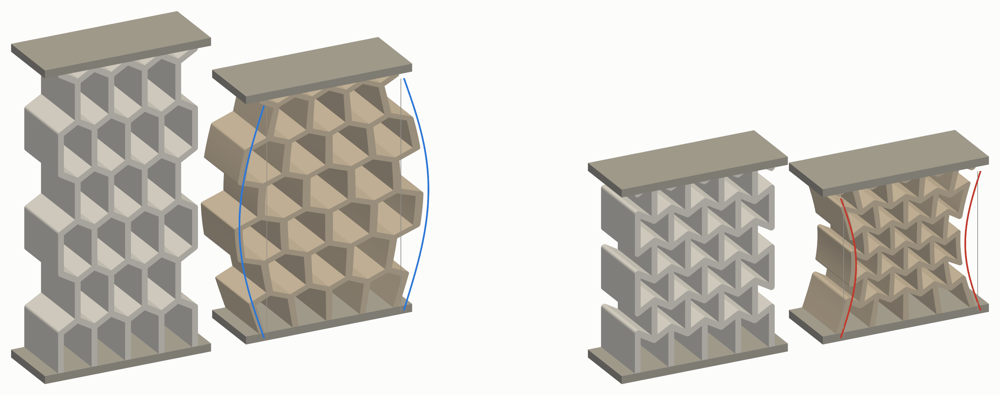
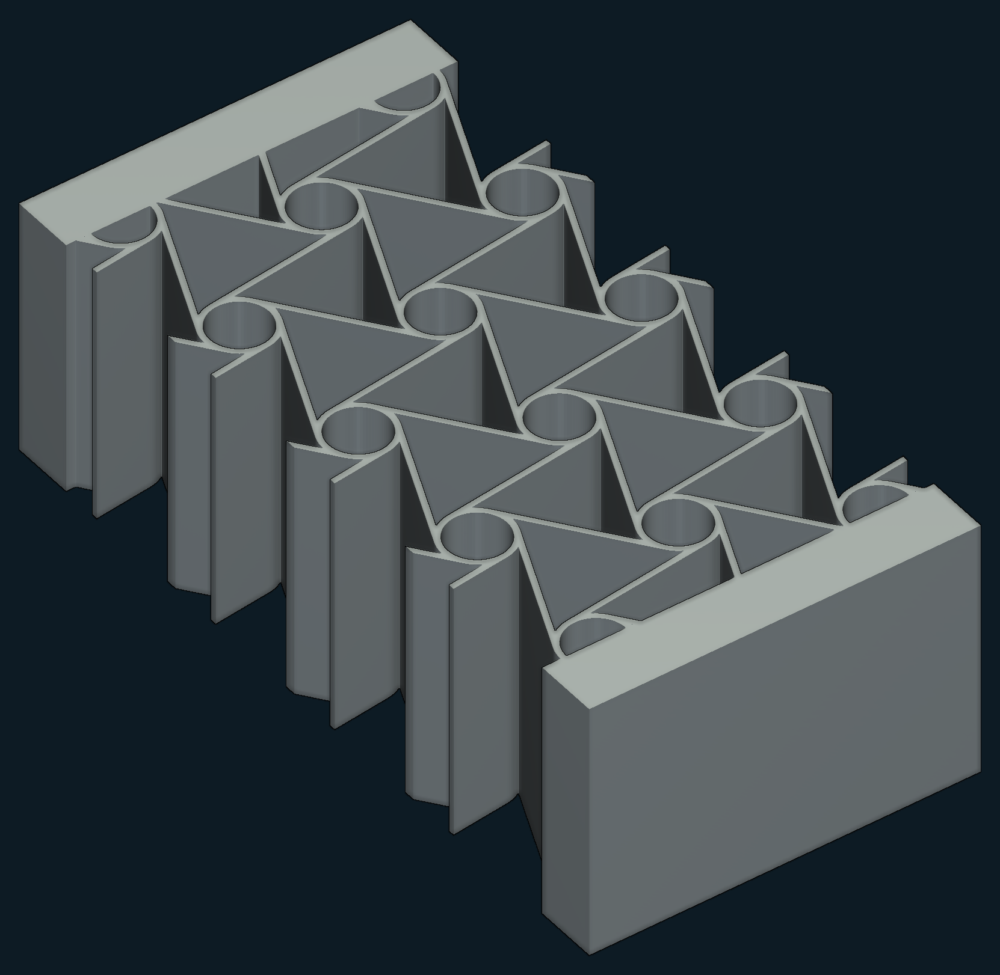
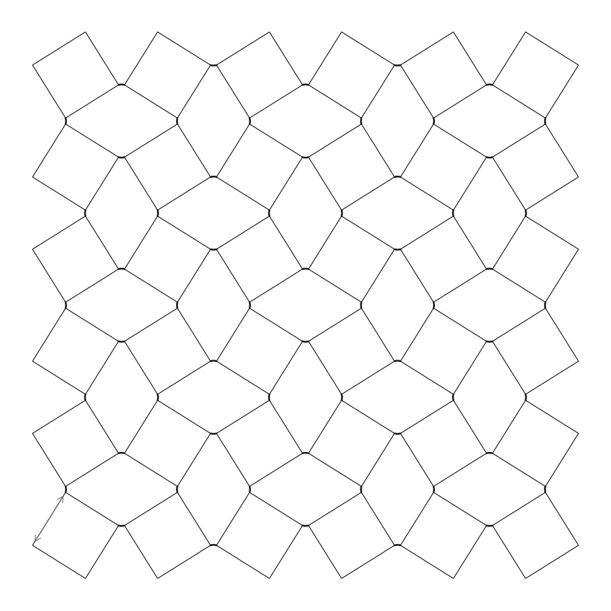

# Metamaterials and Applications

### Geometry that pushes back

**Team "Mettamaterials" · Mechanics of Solids Project 2026–27**

Squeeze a block of rubber and it bulges sideways. Stretch it and it thins. Almost every material does this —
and almost every material can be made to stop.

The trick is geometry. Cut the right pattern of cells into a solid and the cells, not the material, decide how it
moves: squeeze it and it pulls *inward*; stretch it and it *widens*. These are **auxetic** structures, with a
negative Poisson's ratio, and because their behaviour is drawn rather than mixed, it can be designed.

This project builds four of them, from first principles to working applications.

<table align="center">
  <tr>
    <td align="center" width="25%"> <b>Re-entrant</b> cells that fold shut</td>
    <td align="center" width="25%"> <b>Chiral</b> rings that wind up</td>
    <td align="center" width="25%"> <b>Rotating squares</b> tiles that counter-rotate</td>
    <td align="center" width="25%"> <b>Tensegrity</b> struts held by cables</td>
  </tr>
</table>

---

## Four lattices

### ⬡ [Re-entrant honeycomb](reentrant-auxetics/) — *cells that fold shut*
Flip a honeycomb's walls inward and each cell becomes a bow-tie that folds closed under load. Four classic models
were set against a 25-cell ANSYS batch, and the lattice was put under a running foot: a midsole loaded by a real
measured stride, searched for the cell that best trades cushioning against energy absorbed.
**Finding:** every model over-predicts how auxetic a printable cell is — thick joints resist the fold.
[Report](reentrant-auxetics/report/Re-entrant_Auxetics_Report.pdf)

### ◎ [Chiral lattice](chiral-auxetics/) — *rings that wind up*
Rings joined by tangent ligaments all turn the same way under load, winding the ligaments around them, so the
lattice shrinks in every direction at once. Derived from scratch, checked against three published models and a 3D
ANSYS coupon, then built into the core of a morphing aircraft wing section.
**Finding:** the chiral core moves the trailing edge with 21 % less actuator stroke — at 2.5 × the work.
[Report](chiral-auxetics/Hexachiral_Honeycomb_Report.pdf)

### ◇ [Rotating squares](rotating-square-auxetics/) — *tiles that counter-rotate*
Squares hinged at their corners spin in opposite directions and open the gaps between them — a mechanism whose
ideal Poisson's ratio is exactly −1. Three independent models agree to five decimal places; a soft TPU redesign
was then compressed in ANSYS.
**Finding:** stiff hinges yield below 1 % strain; the soft specimen stays auxetic at ν = −0.70.
[Report](rotating-square-auxetics/Rotating_Squares_Report.pdf)

### △ [Tensegrity](tensegrity-structures/) — *struts held by cables*
Not auxetic, but just as strange: compression struts that never touch, suspended in a web of pre-tensioned
cables whose self-stress sets the stiffness. Planar hexagonal tensegrity cells are stacked into a 3D lattice and
compared with the single 2D sheets of the reference study.
**Finding:** one 60° rotation of a cell cuts its stiffness to a third and raises its Poisson's ratio tenfold.
*Report in progress.*

---

## One arc, four times

Every strand follows the same path, so the four can be read side by side:

**Mechanism** → why the geometry behaves as it does
**Models** → closed-form predictions of stiffness and Poisson's ratio
**Simulation** → ANSYS finite-element runs that test them
**Application** → a shoe, a wing, a soft lattice, a graded load-limiter

## What they share

| | Ideal | Simulated | What stands between |
|---|---|---|---|
| Re-entrant | ν −0.44 to −1 | **−0.14** | thick printed joints |
| Chiral | ν −0.95 to −1 | **−0.82** | finite coupon, flexible rings |
| Rotating squares | ν −0.99 to −1 | **−0.70** | stubby ligaments, soft squares |

Every printed lattice is a weaker version of its ideal mechanism. The models capture the trend and rank the
designs — but the walls, joints and ligaments you can actually print are thick, and the real effect is smaller.
Measuring that gap, and designing around it, is what this project is about.

The **[experimental setup](experimental-setup/)** will hold the compression tests of the printed samples once
printing is complete.
