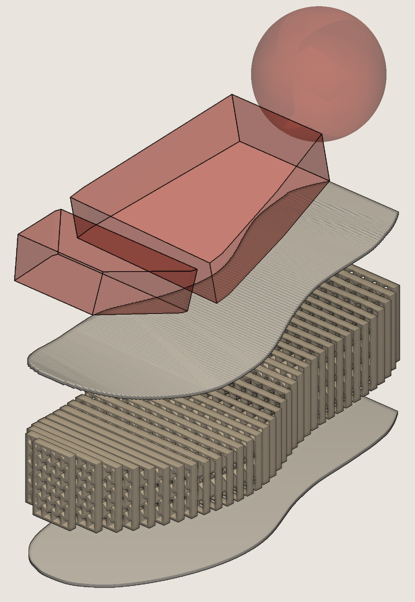
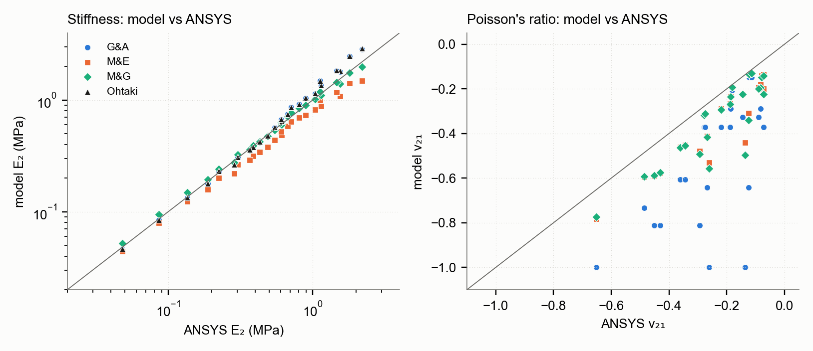
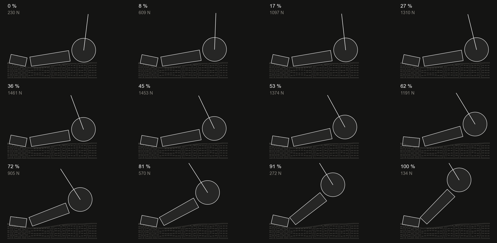

# Re-entrant Auxetics

### From bow-tie cells to a running-shoe midsole

A re-entrant honeycomb is a hexagonal honeycomb with its inclined walls flipped inward, so every cell
becomes a bow-tie. Squash it and the bow-ties fold shut, pulling material *toward* the load instead of
pushing it out — exactly what you want under a foot.

This strand asks two questions:

1. **How well do the textbook models describe a cell you could actually print?** Four analytical models are
   implemented and checked against ANSYS, first on one cell, then on 25.
2. **What happens when that cell goes under a running foot?** A midsole is filled with the lattice, loaded by
   a real measured running stance, and searched for the cell that best balances cushioning against energy
   absorption.

📄 **Read the report:** [Markdown](report/report.md) · [PDF](report/Re-entrant_Auxetics_Report.pdf) · [HTML](report/report.html)

<p align="center">
  
  <br><sub>The finished midsole, exploded: pseudo-foot (red), top plate, 34 zoned lattice slices, bottom plate.</sub>
</p>

---

## Part 1 · Four models, one cell

| Model | What it adds | Verdict against ANSYS |
|---|---|---|
| **Gibson & Ashby** | Walls bend, nothing else | Close on average, up to ~40 % too stiff for thick walls |
| **Masters & Evans** | Walls also stretch; optional joint hinges | Consistently about a fifth too soft — but ranks cells correctly |
| **Malek & Gibson** | Thick walls, rigid joints, shear | **Best: within ±10 % on every cell** |
| **Ohtaki** | Large rotations (elastica) | Only model with the nonlinear rise, but misses buckling |

The forefoot cell (θ −30°, l 4, h 8, t 1.6 mm) came out at **E₂ = 2.20 MPa** and **ν = −0.14** in ANSYS,
and buckles at **0.36 MPa**. The big surprise: *every* model over-predicts how auxetic the cell is. Thick,
printable walls resist the hinge-like rotation that makes the bow-ties fold.

<p align="center">
  
  <br><sub>25 cells, four models, one plane-stress ANSYS batch. On the line = perfect agreement.</sub>
</p>

## Part 2 · The midsole

<p align="center">
  
  <br><sub>One measured stance (213 ms, peak 1523 N), replayed through a three-segment pseudo-foot.</sub>
</p>

- **The foot:** a heel sphere, midfoot block and toe block, posed frame-by-frame from the
  [Fukuchi running dataset](https://peerj.com/articles/3298/).
- **The sole:** 34 lattice slices across the foot, each treated as a beam resting on a bed of lattice columns.
  The foot sinks until the slices push back with exactly the measured force.
- **The search:** 24 candidate cells, each run through the whole stance. Softer cells absorb more energy but
  let the foot sink deeper — roughly **0.6 J extra per extra millimetre of dip**. There is no free lunch, only
  a trade-off front.
- **The design:** a stiffer cell under the forefoot, where the load concentrates, and the softest, most
  auxetic cell for the midfoot and heel.

---

## What's in here

```
reentrant-auxetics/
├── report/               the report (md / pdf / html) and every figure in it
├── models/               the four cell models — MATLAB originals + Python ports
├── midsole/              the midsole pipeline, in run order (see below)
├── ansys/                hand-run setup sheet, test geometry, results, 25-cell batch
├── inputs/               midsole + pseudo-foot CAD, Fukuchi running data
├── outputs/              everything the scripts produce (CSV, PNG, STL, GIF)
└── paths.py              one place for every folder location
```

<details>
<summary><b>Full file map</b></summary>

```
├── models/
│   ├── matlab/               gibson_ashby.m, masters_evans.m, malek_gibson.m, ohtaki.m, build_lattice.m
│   ├── lattice_law.py        Ohtaki large-deflection curve (cached)
│   └── model_compare.py      four models vs ANSYS, comparison figures
├── midsole/
│   ├── fill_midsole.py       fill the midsole with lattice slices → STL
│   ├── foot_motion.py        Fukuchi stance → foot angles + heel/forefoot force split
│   ├── foot_anim.py          view any frame / make the stance GIF
│   ├── foot_conform.py       one frame: posed foot on the slices
│   ├── full_stance.py        every frame, sink solved from force balance
│   └── zone_search.py        pick a lattice per zone
├── ansys/
│   ├── unit_cell_setup.md    how runs A (x₂), B (x₁) and C (large strain) were set up
│   ├── make_block.py         test-block geometry → DXF / STEP / STL
│   ├── geometry/             the generated blocks
│   ├── results/              small-strain values and the run C collapse curve
│   └── grid_plane/           25-cell APDL batch: inputs, run_all.bat, comparison
└── report/
    ├── fig/                  all report figures
    ├── make_figs.py          regenerates them
    ├── to_markdown.py        report.html → report.md
    └── archive/              earlier drafts
```
</details>

## Running it

```bash
# the midsole pipeline
python midsole/foot_motion.py           # running data → foot motion
python midsole/fill_midsole.py          # build the lattice midsole (~3 min)
python midsole/full_stance.py 1         # load it through the whole stance (~1 min)
python midsole/zone_search.py           # choose a cell per zone (~5 min)

# models and report
python models/model_compare.py          # four models vs ANSYS
python report/make_figs.py              # regenerate report figures
python report/to_markdown.py            # refresh report.md
```

**ANSYS batch:** `python ansys/grid_plane/make_grid_plane.py` → double-click `ansys/grid_plane/run_all.bat`
(ANSYS 2025 R1) → `python ansys/grid_plane/compare_grid.py`.

**Requires:** Python 3 with numpy, scipy, pandas, matplotlib, shapely, trimesh, manifold3d, pyvista, Pillow,
beautifulsoup4. MATLAB is optional (the `.m` models also exist as Python).
