# Re-entrant Auxetics

*Cell models, simulation and a running midsole*

MOS Project 2026–27 · Re-entrant strand

**Contents:** [Summary](#summary) · [1 Re-entrant auxetics](#re-entrant-auxetics) · [2 Midsole optimisation](#midsole-optimisation) · [References](#references)

## Summary

Four analytical descriptions of the re-entrant honeycomb — Gibson & Ashby, Masters & Evans, Malek & Gibson and Ohtaki — are implemented and compared with plane-stress finite-element simulations of a printable cell (t/l = 0.4), then across a grid of 25 cells. The models bracket the simulated stiffness — Malek & Gibson is best, within ±10 % on every cell, while Masters & Evans is about a fifth too soft — but every model over-predicts the auxetic effect (forefoot cell: ν21 −0.14 against −0.44 to −1). The cell buckles at 0.36 MPa.

The cell is then applied to a running midsole loaded by a measured stance through a three-segment pseudo-foot. A grid search over cell geometry maps the trade-off between how far the foot sinks (dip) and how much energy the midsole absorbs.

---

**PART ONE**

# Re-entrant auxetics

## 1.1 Developments in re-entrant auxetics

Poisson's ratio ν describes how a material changes width when loaded along its length. For almost every common material ν lies between 0 and 0.5. Negative values were long considered a theoretical curiosity — Love's elasticity text noted them in certain crystals [1] — until Lakes produced a polymer foam with a *re-entrant* cell structure and a Poisson's ratio near −0.7 [2]. Evans and co-workers named such materials *auxetic* [3].

The re-entrant honeycomb is the simplest auxetic geometry: a hexagonal honeycomb whose inclined walls point inward, giving a bow-tie cell. Its in-plane mechanics were laid out in the honeycomb work of Gibson and co-workers [4] and collected in *Cellular Solids* [5]. Since then the models have been extended for wall stretching and hinging [6], large rotations [7] and rigid, thick joints [8], and additive manufacturing has made the geometry easy to produce. Reviews now list sport and footwear among its most promising applications [9].

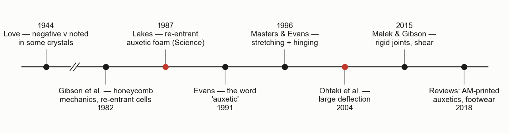

**Fig. 1** A short timeline (not to scale). Red: the two developments this report relies on most — re-entrant foam and large-deflection modelling.

---

## 1.2 The models, from Gibson & Ashby to Ohtaki

All four models idealise the cell walls as beams and relate the cell's in-plane properties to its geometry: the vertical wall h, the inclined wall l, the wall thickness t, the depth b and the wall angle θ (negative for re-entrant). They differ in which wall deformations they keep, and the progression is one of adding mechanisms.

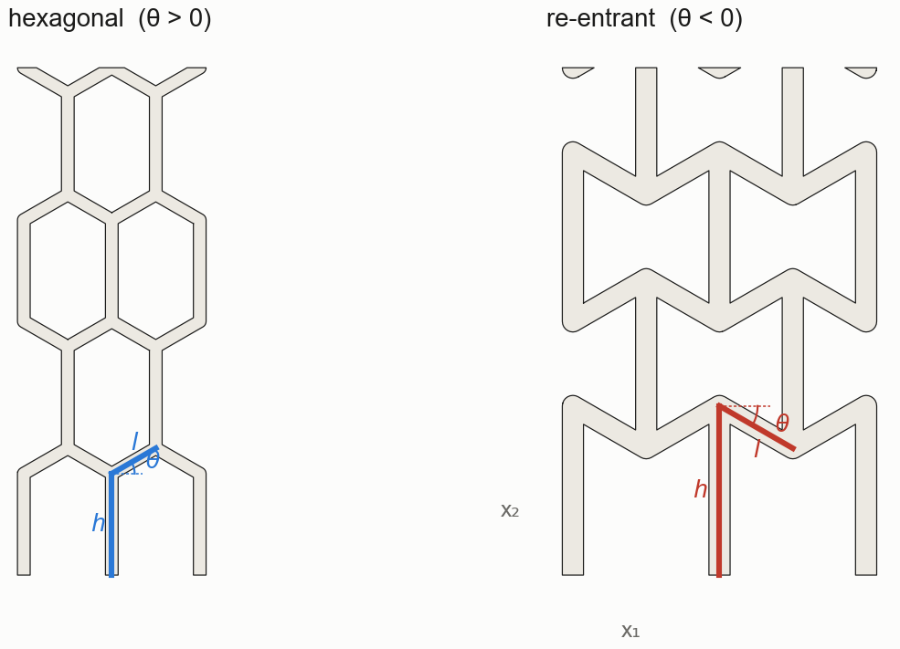

**Fig. 2** Hexagonal and re-entrant cells with the same wall lengths. Turning θ negative folds the inclined walls into the cell.

The three linear models can be written in one compliance form. Each inclined wall deforms perpendicular to its axis with compliance Cp and along it with Ca; the vertical wall stretches with Cv. In units of $l^3/(E_s\, b\, t^3)$, with $\alpha = h/l$ and $\beta = t/l$:

$$
D_1 = \sin^2\theta\, C_p + \cos^2\theta\, C_a, \qquad D_2 = \cos^2\theta\, C_p + \sin^2\theta\, C_a + C_v \tag{1}
$$

$$
E_1 = \frac{E_s\,\beta^3 \cos\theta}{(\alpha + \sin\theta)\,D_1}, \qquad E_2 = \frac{E_s\,\beta^3 (\alpha + \sin\theta)}{\cos\theta\, D_2} \tag{2}
$$

$$
\nu_{12} = \frac{\sin\theta \cos^2\theta\,(C_p - C_a)}{(\alpha + \sin\theta)\,D_1}, \qquad \nu_{21} = \frac{\sin\theta\,(\alpha + \sin\theta)(C_p - C_a)}{D_2} \tag{3}
$$

### Gibson & Ashby — bending only

The walls only bend: $C_p = 1,\ C_a = C_v = 0$ [5]. The model is simple and captures the auxetic mechanism, but it treats the walls as infinitely stiff axially and the joints as points. For $\theta = -30^\circ$ with $h/l = 2$ it gives exactly $\nu = -1$ and $E_1 = E_2$.

### Masters & Evans — stretching and hinging

Masters and Evans add axial stretching of the inclined walls ($C_a = \beta^2$) and of the vertical walls ($C_v = 2\alpha\beta^2$), and an optional hinge spring at the joints, $C_p = 1 + K_f/K_h$ [6]. Stretching softens the cell and weakens the auxetic effect, since a wall that shortens no longer has to rotate.

---

### Malek & Gibson — thick walls and rigid joints

For walls that are not slender, the joint is a solid block and only the remaining lengths $l_b = l - t/(2\cos\theta)$ and $h_b = h - t(1 - \sin\theta)/\cos\theta$ bend. Malek and Gibson also add Timoshenko shear, $C_p = 1 + (2.4 + 1.5\nu_s)(t/l_b)^2$ [8]. Shorter bending lengths stiffen the cell, while shear softens it. The paper validates $\theta > 0$; negative $\theta$ is an extrapolation.

### Ohtaki — large deflection

The three models above are linear. Ohtaki and co-workers instead treat each half inclined wall as an *elastica*, an inextensible beam free to rotate by large angles [7]. With $\varphi(s)$ the wall angle along its length and forces scaled by $E_s I/(l/2)^2$,

$$
\varphi'' = f_x \sin\varphi - f_y \cos\varphi, \qquad \varphi(0) = \theta, \quad \varphi'(1) = 0 \tag{4}
$$

The boundary-value problem is solved by shooting at each load step. The result is a nonlinear stress–strain curve and a Poisson's ratio that changes with strain. Its first step equals Gibson & Ashby. Because the walls cannot stretch, the response stiffens sharply as they straighten; the model does not include wall contact or buckling.

| Model | Bending | Stretching | Hinging | Shear | Rigid joints | Large rotation |
|---|---|---|---|---|---|---|
| Gibson & Ashby | ✓ |  |  |  |  |  |
| Masters & Evans | ✓ | ✓ | optional |  |  |  |
| Malek & Gibson | ✓ | ✓ |  | ✓ | ✓ |  |
| Ohtaki | ✓ |  |  |  |  | ✓ |

Table 1. Mechanisms kept by each model.

---

## 1.3 Setup for the analytical models

Each model is a short function with its test call at the top of the file, written first in MATLAB and ported to Python where the midsole work needed it. Ohtaki's shooting problem is integrated with an adaptive Runge–Kutta solver; the shooting parameter φ′(0) is carried from one load step to the next, and the force step is halved whenever the strain jumps by more than 1 %, which keeps the soft x2 direction stable. The compression curves are cached per geometry.

All comparisons use the cell later chosen for the forefoot of the midsole, and a softer cell used in the midfoot and heel:

| Cell | θ | l (mm) | h (mm) | t (mm) | h/l | t/l |
|---|---|---|---|---|---|---|
| Forefoot | −30° | 4 | 8 | 1.6 | 2.0 | 0.40 |
| Midfoot / heel | −30° | 5 | 10 | 1.0 | 2.0 | 0.20 |

The solid is a thermoplastic polyurethane, Es = 19.3 MPa, νs = 0.45. Every stiffness in this report scales linearly with Es, so a measured value can be substituted directly.

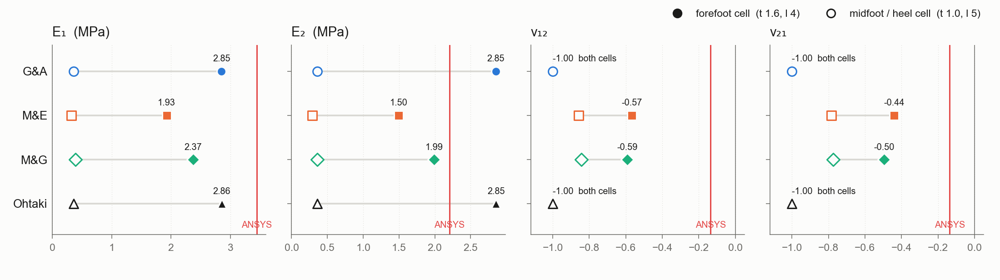

**Fig. 3** Small-strain properties from the four models. Filled: forefoot cell; open: midfoot/heel cell. The red line is the ANSYS result for the forefoot cell (Section 1.5).

The models span a factor of two in stiffness and in Poisson's ratio for the same cell. Adding stretching or shear softens the cell and weakens the auxetic effect; shortening the bending length stiffens it.

---

## 1.4 Setup of the ANSYS simulation

A 4 × 4 block of the forefoot cell was modelled in ANSYS Mechanical 2025 R1. The right edge is closed with a column of vertical walls and the top mirrors the bottom, so the block is 180° symmetric (27.7 mm wide, walls 56 mm tall). Solid strips of wall thickness carry the load into the lattice — top and bottom for x2 loading, left and right for x1. The outline was generated as an exact closed curve and imported as a 2D plane-stress surface, 5 mm thick (one midsole slice), meshed with quadrilaterals of about 0.3 mm, at least four through each wall.

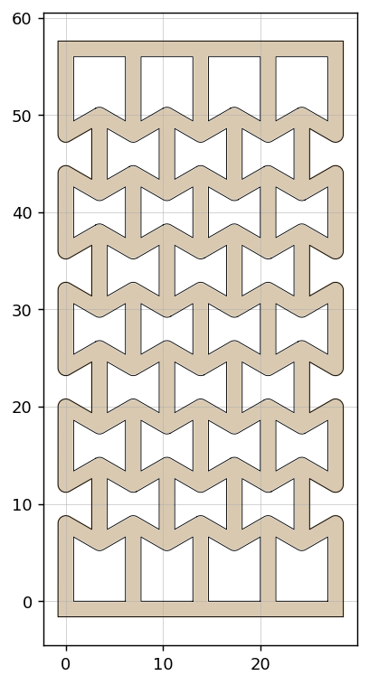

**Fig. 4a** Block for runs A and C.

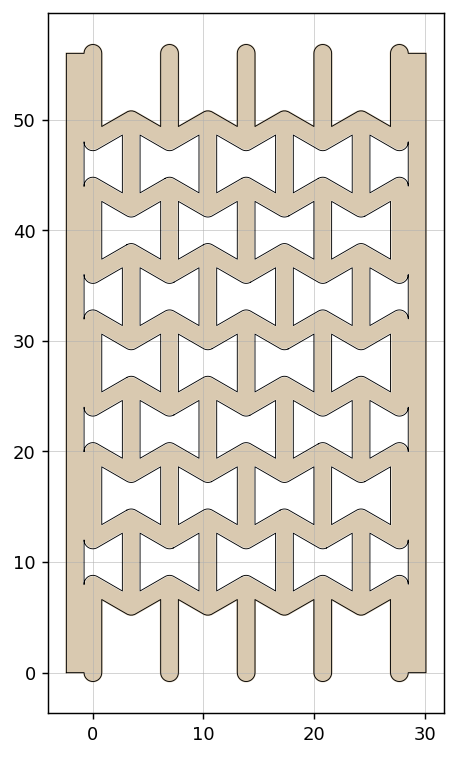

**Fig. 4b** Block for run B.

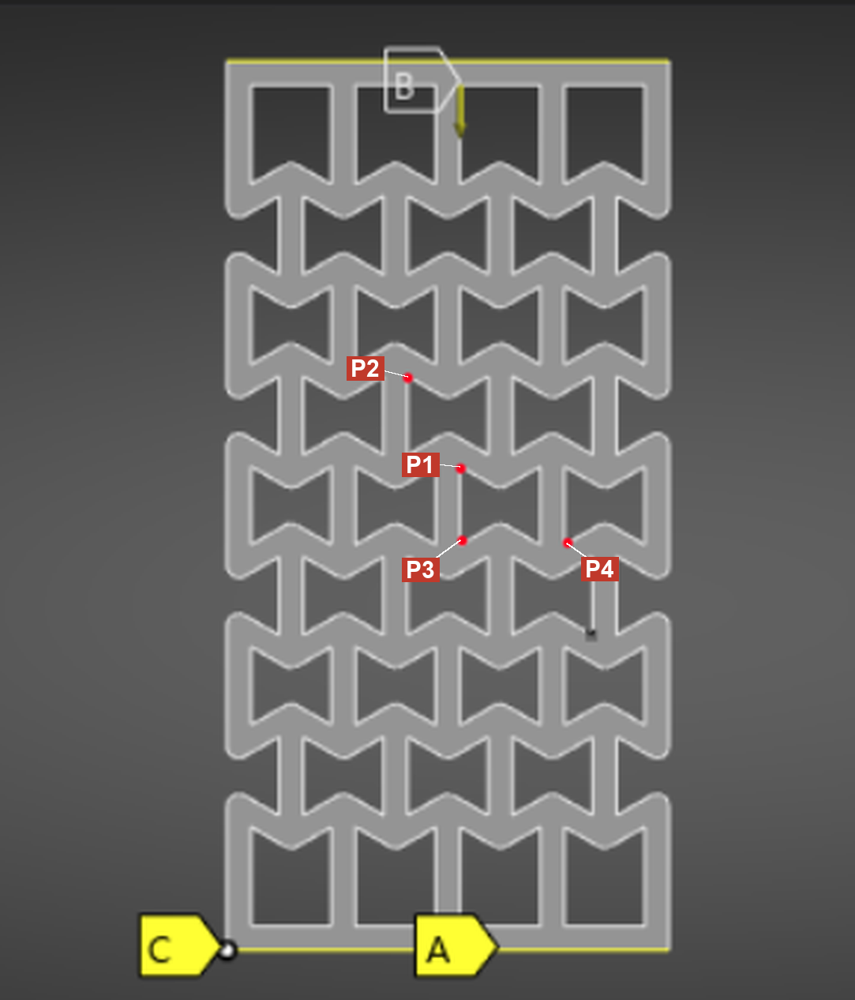

**Fig. 4c** Run A model: supports A and C at the bottom strip, displacement B at the top; red dots are probes P1–P4.

| Run | Load | Material | Solver |
|---|---|---|---|
| A | x2 compression, 0.56 mm (1 %) | linear elastic | small deflection |
| B | x1 tension, 0.277 mm (1 %) | linear elastic | small deflection |
| C | x2 compression to 16.8 mm (30 %) | Neo-Hookean, μ 6.66 MPa, D1 0.0311 MPa⁻¹ | large deflection, auto substeps |

One strip is fixed in the load direction and pinned at a single vertex; the other is displaced. Cell strains are measured away from the strips, on the middle 2 × 2 cells, from four probes at wall joints: ε2 over the 12 mm cell pitch and ε1 over 6.93 mm. Stress is the strip reaction over the loaded cross-section. The Neo-Hookean constants match the linear material at small strain ($\mu = E/2(1+\nu)$, $D_1 = 2/K$); run C reproduced run A to within 4 % at 1 %.

---

## 1.5 Comparison, justifications and observations

### Small strain

| Forefoot cell | E1 (MPa) | E2 (MPa) | ν12 | ν21 |
|---|---|---|---|---|
| ANSYS | 3.45 | 2.20 | −0.14 | −0.14 |
| Gibson & Ashby | 2.85 (−17 %) | 2.85 (+30 %) | −1.00 | −1.00 |
| Masters & Evans | 1.93 (−44 %) | 1.50 (−32 %) | −0.57 | −0.44 |
| Malek & Gibson | 2.37 (−31 %) | 1.99 (−10 %) | −0.59 | −0.50 |
| Ohtaki (first step) | 2.86 (−17 %) | 2.85 (+30 %) | −1.00 | −1.00 |

Table 2. Forefoot cell, small strain. Percentages: model error relative to ANSYS.

**The models bracket the stiffness but all over-predict the auxetic effect.** For the forefoot cell, Malek & Gibson lands within 10 % of ANSYS; the bending-only models are 30 % too stiff and Masters & Evans 32 % too soft. Poisson's ratio is −0.14 in ANSYS against −0.44 to −1 in the models.

- *Bending is not the only mechanism.* Walls this thick also stretch and compress, which softens the cell relative to the bending-only models; Masters & Evans adds stretching but, with point joints, overshoots.
- *Joint size.* The solid joints shorten the bending length — Malek & Gibson's correction, which is why it comes closest.
- *Weak auxetic effect.* A wall that shortens no longer has to rotate, and stiff joints resist the hinge-like rotation that produces the negative Poisson's ratio.

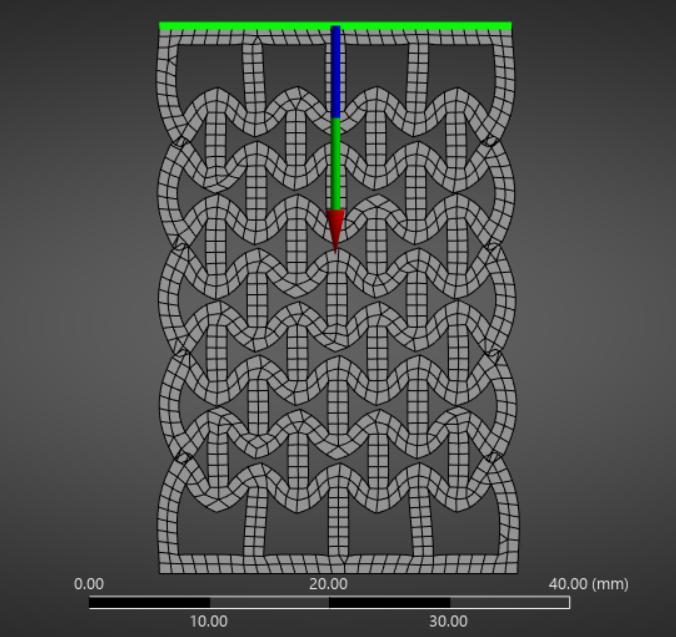

**Fig. 5a** Run A, vertical compression at 1 % (deformation exaggerated).

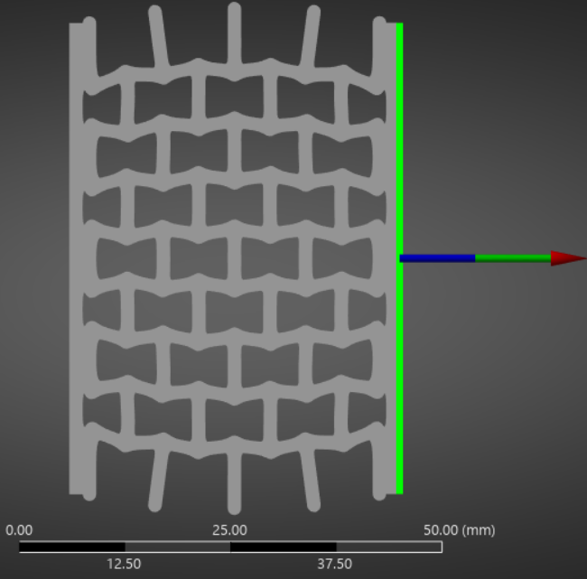

**Fig. 5b** Run B, sideways tension at 1 % (deformation exaggerated).

---

### Large strain and collapse

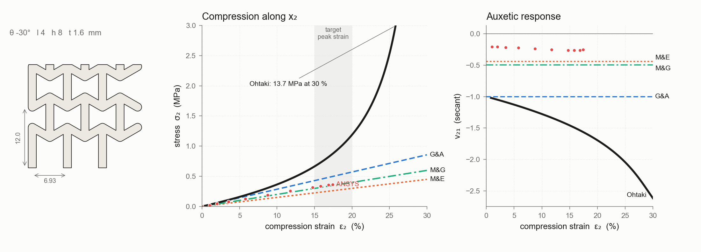

**Fig. 6** Forefoot cell under x2 compression: cell (left), stress–strain (centre) and Poisson's ratio (right). ANSYS points shown up to the load peak, against whole-block strain (which the batch runs show tracks the middle cells to within about 6 %).

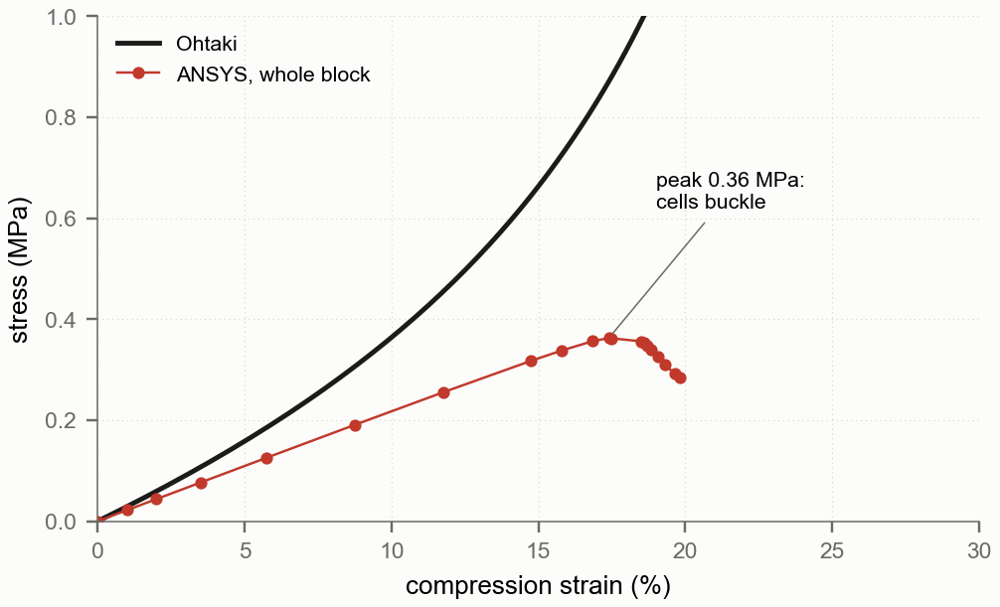

**Fig. 7** Run C in full: stress against whole-block strain, with Ohtaki for reference.

The stress rises almost linearly to a peak of **0.36 MPa** at 17 % strain, then falls: the cells buckle and the deformation localises in a few rows. The solution stopped at 20 % on element distortion, with collapse well under way.

ANSYS starts about 30 % below Ohtaki — consistent with run A — and falls further behind as Ohtaki stiffens; Ohtaki's runaway stiffening past 20 % never happens, because the real cell buckles first. The linear models stay straight and sit close to ANSYS until the peak.

**Observations.** For the forefoot cell, Malek & Gibson gives the best stiffness and every model over-predicts the auxetic effect. Ohtaki captures the shape of the nonlinear rise but not its level, and no model predicts buckling, which for this cell sets the useful stress at about 0.36 MPa. Section 1.6 tests these conclusions across the whole grid.

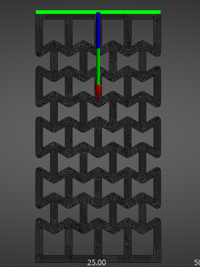

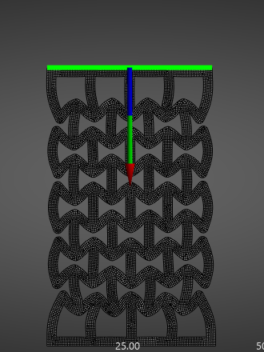

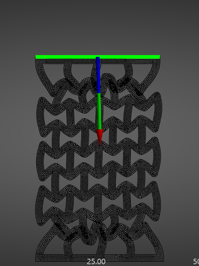

**Fig. 8** Run C deformed shapes at true scale: undeformed (left), at the load peak (centre) and after collapse (right), where rows near the strips fold first.

---

## 1.6 The models across 25 cells

One cell cannot rank four models, so the same plane-stress analysis was batched over every cell of the Part 2 grid search (24 cells) plus the forefoot and midfoot/heel cells. A script writes each 4 × 4 block — rounded joints and wall ends, as in the hand-run model — as a self-contained APDL file: PLANE182 plane stress, 5 mm thick, mesh size t/4, run A loading and the same four joint probes. All 25 cells solved in ANSYS Mechanical APDL in a few minutes, at 6 500–15 600 nodes.

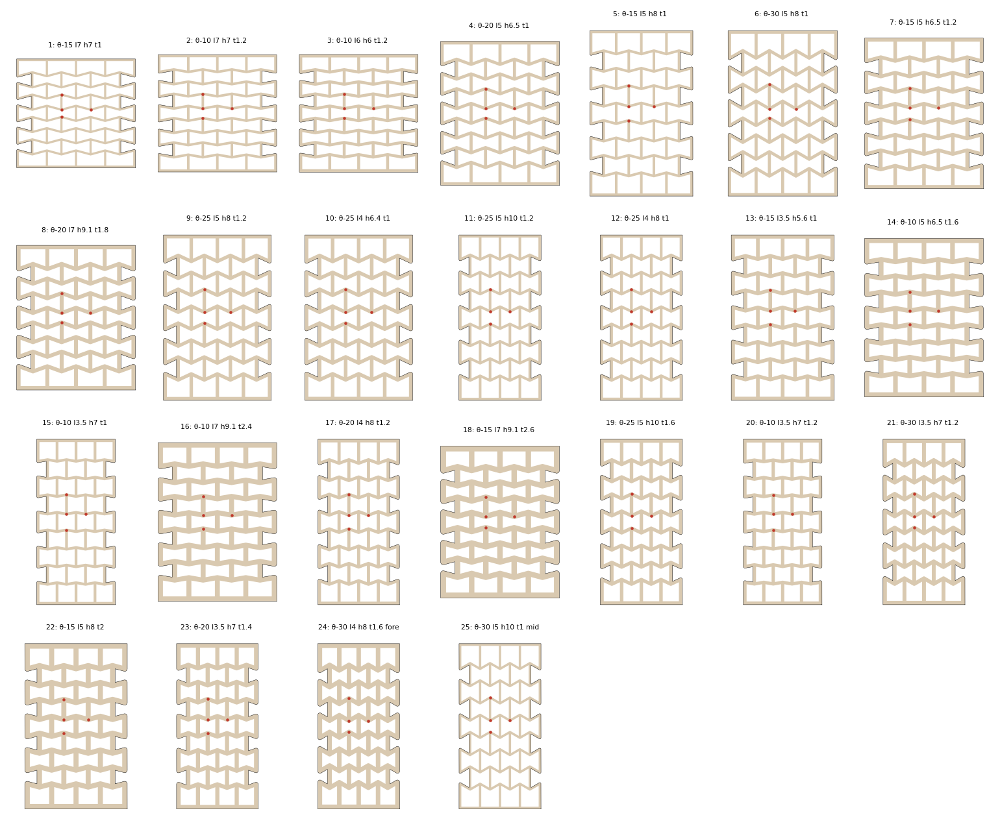

**Fig. 8b** The 25 blocks as meshed, with the four probe joints (red). Cells 24 and 25 are the forefoot and midfoot/heel cells.

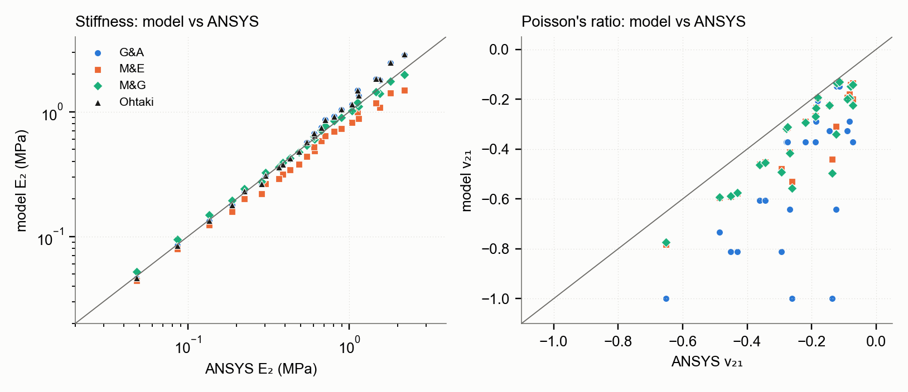

**Fig. 8c** Model against ANSYS for all 25 cells: stiffness (left, logarithmic) and Poisson's ratio (right). The line marks perfect agreement.

| E2 error vs ANSYS | median | range | ν21 |
|---|---|---|---|
| Malek & Gibson | +1 % | −10 to +10 % | 0.1–0.3 too negative |
| Gibson & Ashby | +5 % | −9 to +37 % | far too negative |
| Ohtaki (first step) | +6 % | −8 to +38 % | as Gibson & Ashby |
| Masters & Evans | −19 % | −32 to −8 % | 0.1–0.3 too negative |

**Across the grid, Malek & Gibson predicts stiffness best**, within ±10 % on every cell: its shorter bending lengths capture the solid joints of the printed geometry. The bending-only models are close on average but drift up to about 40 % too stiff for thick walls at shallow angles (θ −10° to −15°, t/l ≥ 0.3); Masters & Evans, which the search used to rank cells, is consistently about a fifth too soft, so its ranking holds but its values are low. Every model over-predicts the auxetic effect; the thick, shallow cells are barely auxetic in ANSYS (ν21 ≈ −0.1), while the slender θ −30° cells come closest to the predictions.

---

**PART TWO**

# Midsole optimisation

## 2.1 Literature survey

Published work on optimising lattice midsoles against measured running loads is thin. The closest study found, *Multidisciplinary optimization of shoe midsole structures using swarm intelligence* [10], couples a midsole structure to a population-based optimiser and is the prime motivation for this part: it shows that midsole geometry can be searched systematically against several objectives at once (Fig. 9). The work in this part is loosely based on, and inspired by, that loop: a fixed design domain is filled with a parametrised lattice, each candidate is evaluated against more than one objective, and the best compromise is chosen. It replaces the swarm optimiser with a transparent grid search, the scanned foot with a measured running stance and a pseudo-foot, and the finite-element evaluation with analytical lattice laws checked against ANSYS.

Elsewhere, the literature splits into three strands that rarely meet: auxetic mechanics (Part 1 and [9]), running biomechanics — ground reaction forces of two to three body weights and 30–40° of toe bend before toe-off [11] — and additively manufactured lattice midsoles, which are now commercial but mostly conventional rather than auxetic.

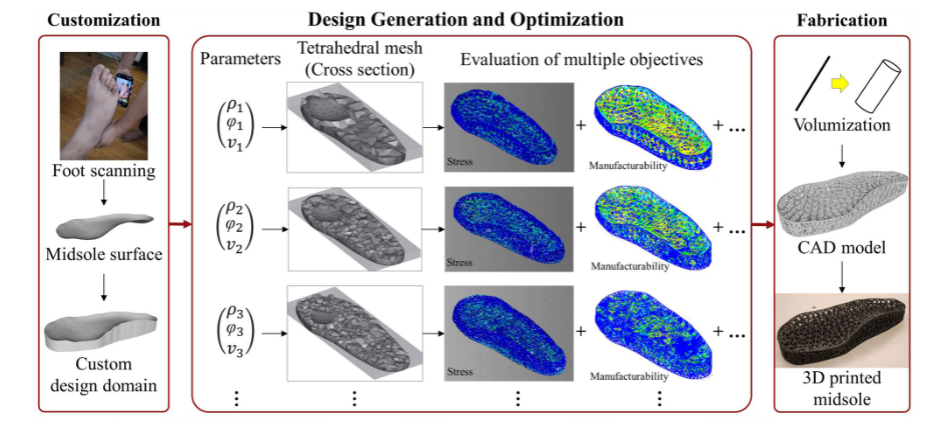

**Fig. 9** The optimisation loop of [10]: a custom design domain from a foot scan, a parametrised lattice evaluated against several objectives, and fabrication of the chosen midsole. Reproduced from [10].

---

## 2.2 How re-entrant auxetics help

A midsole works in compression. A conventional honeycomb or foam has a positive Poisson's ratio, so under the foot it *barrels*: material flows sideways and away from the load, the sole spreads, and support under the foot drops just when it is needed. A re-entrant lattice does the opposite. Its cells fold inward, drawing material under the load and densifying where the foot presses.

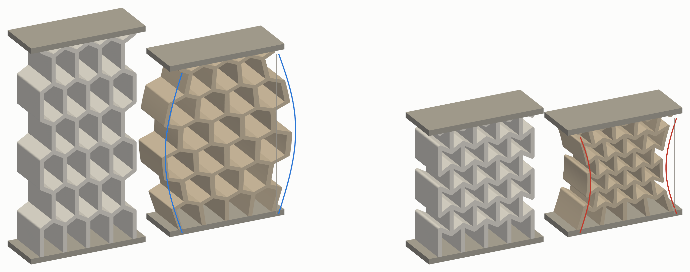

**Fig. 10** The same compression (22 %) on a hexagonal block (left pair) and a re-entrant block (right pair). Thin grey lines: original width; coloured curves: the deformed sides. The hexagonal block barrels outward; the re-entrant block draws inward. Illustrative deformation, exaggerated for clarity.

The study *Large deformation and collapse analysis of re-entrant auxetic and hexagonal honeycombs* follows both lattices through collapse. After the elastic rise, each passes through a plateau as rows of cells buckle and then densifies as walls meet. The difference lies in the plateau: the hexagonal lattice spreads sideways while the re-entrant lattice contracts and stays compact — the behaviour seen in run C (Fig. 7), where the cells buckled at 0.36 MPa and the stress levelled off. For a midsole this is desirable on both counts: the plateau caps the peak force on the foot, and the inward contraction keeps the material under the load rather than squeezing it out.

**Fig. 11** Elastic rise, peak and onset of the plateau in the re-entrant cell (run C).

---

## 2.3 The question

> Within a printable range of cell parameters, which re-entrant cell minimises how far the foot sinks into the midsole (the **dip**) while maximising the **energy absorbed** during loading?

The two goals conflict. A soft lattice absorbs more energy for the same load, because it deforms further, but lets the foot sink deeper; a stiff lattice limits the dip but absorbs little. The aim is therefore not a single optimum but the set of cells that offer the best compromise — the trade-off front — and a choice along it.

## 2.4 Setup and design choices

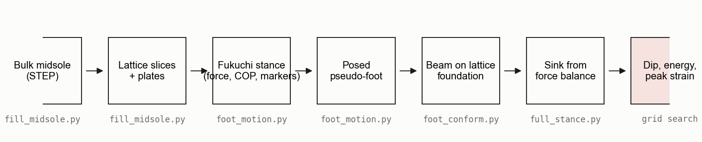

**Fig. 12** The evaluation chain. Each candidate cell passes through every step; the script for each is shown underneath.

### The midsole

A bulk midsole volume (flat bottom, curved footbed, 270 mm) is cut into 34 slices across the foot, 5 mm thick with 3 mm gaps, each filled with the lattice and closed by a skin wall. Bottom and top plates join the slices. Slicing across the foot puts each lattice in the y–z plane, with x2 vertical — along the foot load — so the Part 1 models apply directly.

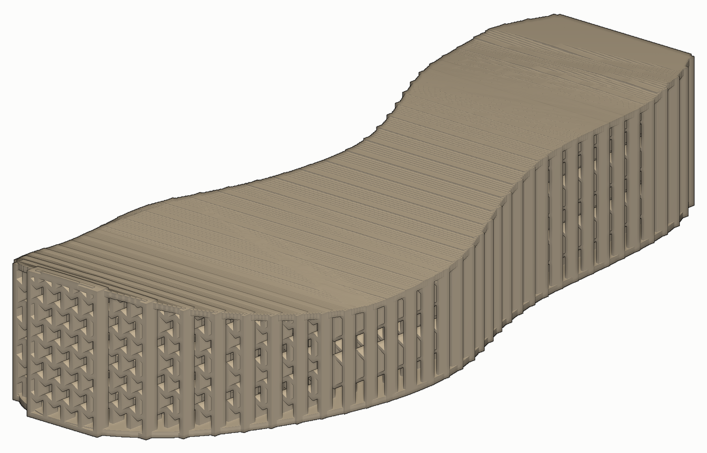

**Fig. 13a** The filled, zoned midsole: 34 lattice slices on a bottom plate, under a top plate following the footbed.

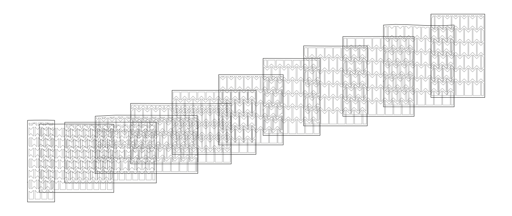

**Fig. 13b** Slice stack (every third slice).

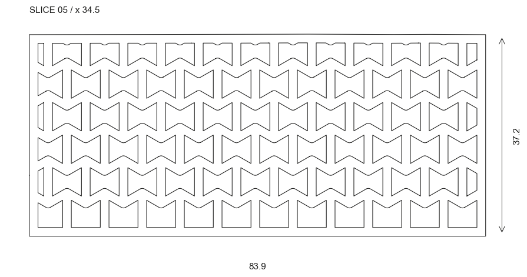

**Fig. 13c** One forefoot slice.

---

### The pseudo-foot

The foot is reduced to three rigid bodies: a heel sphere, a midfoot block and a toe block, hinged along y at the ankle, between heel and midfoot, and at the metatarsophalangeal (MTP) joint. Heel and midfoot are held rigid together because the dataset has no midfoot marker. Hinge positions were placed on the bodies' faces: three-quarters up the midfoot's rear face, and 60 % up the gap between midfoot and toes.

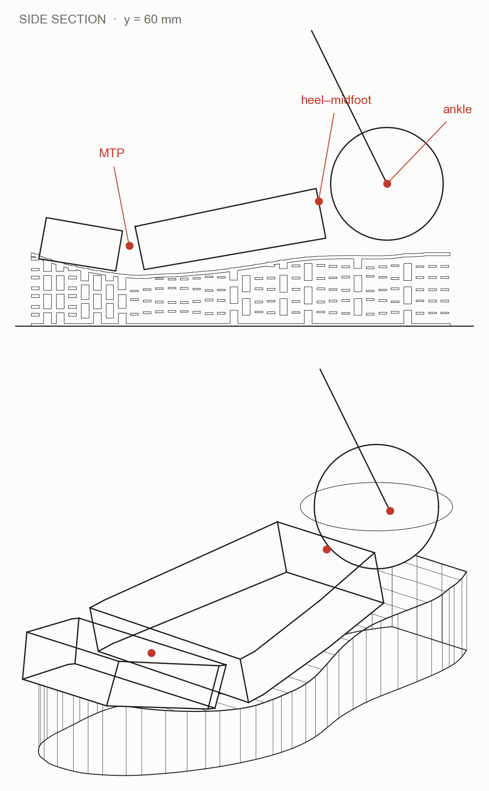

**Fig. 14** Pseudo-foot at mid-stance on the midsole: side section at y = 60 mm (top) and isometric view (bottom). Red: the ankle, heel–midfoot and MTP hinges.

### The running stance

One right-foot stance (213 ms, peak 1523 N) of subject 1 at 3.5 m/s is taken from the Fukuchi dataset [12]. The vertical force and the centre of pressure, projected onto the heel–metatarsal line, split the load between heel and forefoot. Heel and metatarsal markers give the foot's pitch, shank markers the ankle angle, both relative to standing; the MTP bend follows Stefanyshyn & Nigg [11]. A zero-lag exponential moving average smooths all signals. This runner lands on the forefoot, so the heel carries little load.

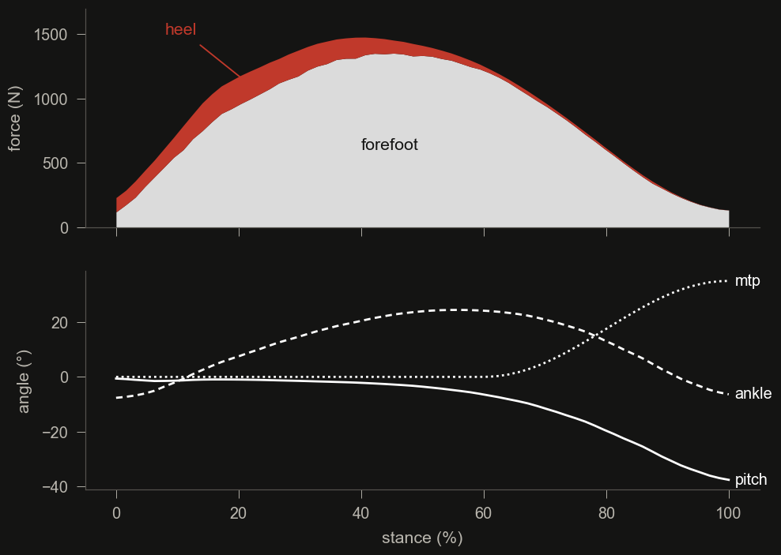

**Fig. 15** Forefoot (white) and heel (red) force, and the three joint angles, through the stance.

---

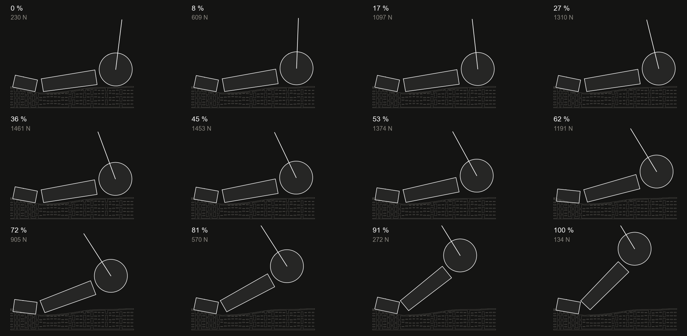

**Fig. 16** Twelve frames of the stance: the pseudo-foot posed from the measured angles over the midsole section.

### Loading the slices

For each frame the posed foot is lowered into the midsole by a sink. In every slice, the top plate and skin form a beam across the foot resting on a Winkler foundation of lattice columns; each column's stress follows Ohtaki's compression curve at its strain, and the rigid foot acts as an indenter. The sink is solved so that the summed slice forces equal the measured force. Ohtaki is used because it is the only one of the four models that follows the nonlinear rise up to buckling (Section 1.5).

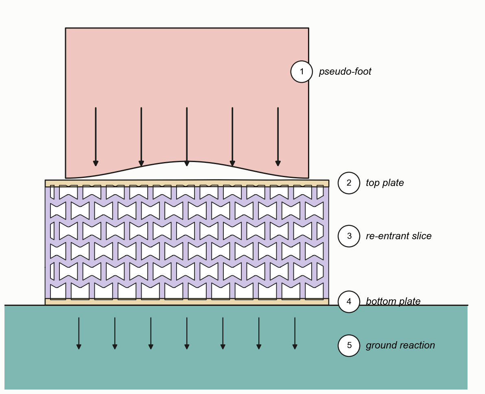

**Fig. 17** Load path across a forefoot slice: (1) foot, (2) top plate, (3) lattice, (4) bottom plate, (5) ground.

### Why the midsole is not bent as a whole

The pseudo-foot bends at the MTP, but the midsole itself is not bent as a whole. This is a choice of scope. Cushioning and comfort are decided by the material sandwiched between the foot and the ground, and that is the region this study models: each slice compressed between the posed foot above and the ground below.

Bending of the whole midsole does occur, and it shares stress between regions of the sole. Those effects are real but lie outside the scope of this report.

---

## 2.5 Grid search and findings

### Process

The candidate space covers θ from −10° to −30°, l from 3.5 to 7 mm, h/l from 1 to 2 and t from 1.0 to 2.6 mm. Three printability limits reduce the raw combinations to a usable set: t/l ≤ 0.4, a clear gap of at least 2 mm inside each bow-tie, and a cell no taller than 16 mm so that at least three cells fit in the midsole's height. From the remaining 200 candidates, 24 were spread evenly across the stiffness range and each was evaluated over the whole stance, with the same cell throughout the midsole:

- **dip** — the largest sink of the foot over the stance;
- **energy absorbed** — the work done on the midsole while loading, ∫F d(sink) up to the largest sink;
- **peak column strain** — the largest lattice strain anywhere, to be read against the 0.36 MPa buckling limit.

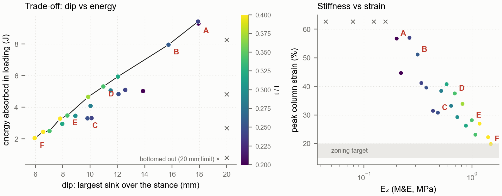

**Fig. 18** Left: dip against energy for 24 cells, coloured by t/l; the line joins the non-dominated cells (the trade-off front). Right: stiffness against peak strain; shaded band 15–20 %. Letters mark the examples of Fig. 19.

**Findings.** The four softest cells (E2 ≤ 0.16 MPa) cannot carry the stance: the foot sinks past the 20 mm search limit and the midsole bottoms out. Among the remaining twenty, dip and energy rise together along an almost straight front, about 0.6 J of extra absorption for every extra millimetre of dip, from 2.0 J at 5.9 mm (F) to 9.3 J at 17.9 mm (A). There is no free lunch: a cell that absorbs more lets the foot sink further. The front is formed mainly by *thicker-walled* cells (t/l 0.3–0.4, green–yellow); thin-walled cells (t/l ≈ 0.2–0.25) sit below it, absorbing 15–30 % less energy for the same dip because their Ohtaki curves stay flat for longer and then stiffen abruptly.

---

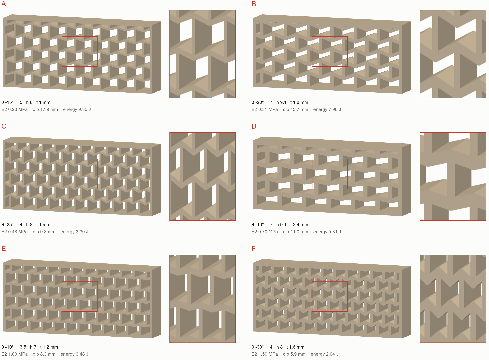

**Fig. 19** Six cells along the stiffness range (A softest, F stiffest), each rendered as a forefoot slice of the midsole with the boxed region enlarged to its right. Labels give the cell, its stiffness and its dip and energy over the stance.

Two further observations follow from Fig. 19. First, geometry matters beyond stiffness: cells C and E have similar dip (9.8 and 8.3 mm) but E, with a shallower angle and thicker walls, absorbs 5 % more energy at 1.5 mm less dip. Shallow angles (θ −10° to −20°) populate most of the front, but they are also the least auxetic, so the energy gained is paid for in lateral support; θ −30° cells such as F sit on the front only at the stiff end. Second, most feasible cells exceed the 17 % strain at which the ANSYS cell buckled (Part 1), so in reality they would reach the collapse plateau under this runner — which, as Section 2.2 argues, is the regime a re-entrant midsole is designed to use. A sensible single-cell choice sits at the knee of the front, between E and D: 8–11 mm of dip for 3.5–5.3 J. Zoning (below) refines this by putting a stiffer cell where the load concentrates.

---

### Repeating the search with ANSYS stiffness

The search above used Ohtaki's curve for every cell, whose initial stiffness Section 1.6 shows is up to about 40 % too high. It was therefore repeated with each cell's curve scaled so that its initial stiffness equals the ANSYS value, keeping its shape; the scale factor ranged from 0.72 to 1.09. Every other step — pose, sink, slices — was unchanged.

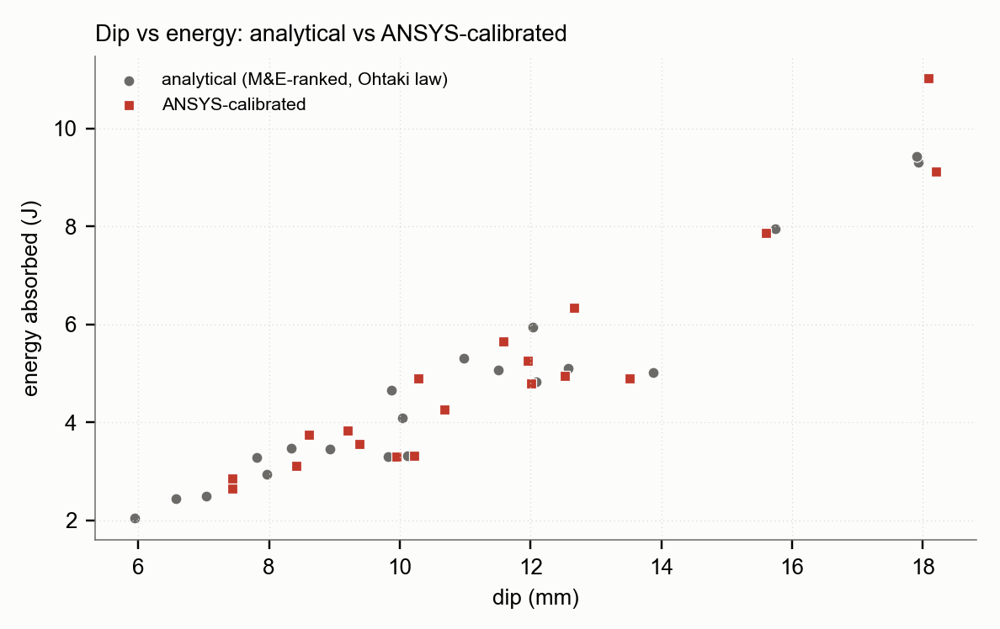

**Fig. 19b** Dip against energy for the analytical search (grey) and the ANSYS-calibrated search (red). Cells that bottom out are not shown.

**Most cells become slightly softer, so the foot sinks a little further.** The same four cells bottom out, and the smallest dip among the grid cells rises from 6.6 to 7.4 mm. The trade-off itself barely moves: the calibrated points follow the same nearly linear front of about 0.6 J of extra absorption per extra millimetre of dip, so its conclusions stand. A cell chosen from the analytical search would, in reality, dip by between 3 % less and 13 % more (median +4 %).

For the zoned design the correction runs the other way in the forefoot: its cell's ANSYS stiffness (2.20 MPa) is higher than the Masters & Evans value used for zoning (1.50 MPa), so the forefoot strains would sit below the predicted 19.8 %.

---

### Zoning the midsole

The load is not uniform: strain gathers under the metatarsal heads, and the heel of this forefoot-striking runner barely loads. Splitting the midsole at the hinge lines and steering each zone toward a peak strain of 17.5 % gives a stiffer forefoot cell (θ −30°, l 4, h 8, t 1.6 mm) and the softest, most auxetic cell allowed for midfoot and heel (l 5, h 10, t 1.0 mm). In the midfoot and heel, strain is set by the foot's shape sinking into the sole rather than by force, so softer cells barely change it.

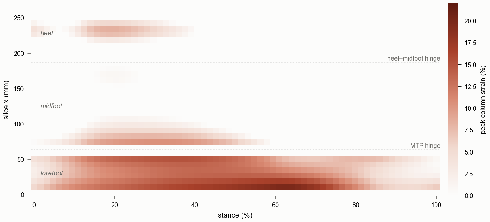

**Fig. 20** Peak column strain per slice through the stance, zoned lattice. Dashed: hinge lines.

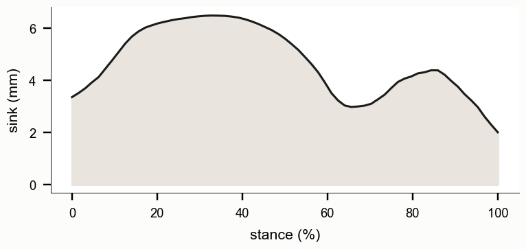

**Fig. 21** Sink per frame, zoned lattice.

Part 1 revises the forefoot result: at t/l = 0.4 the simulated cell is about 1.5 times stiffer than the Masters & Evans value used in zoning and far less auxetic (ν21 −0.14), so real forefoot strains would sit below the predicted 19.8 %. A thinner wall (t/l ≈ 0.25–0.3) keeps more of the auxetic effect.

---

### The zones, up close

Figure 21b shows one slice from each zone, rendered in 3D and enlarged at the boxed region. The forefoot cell is smaller and thick-walled, so its bow-ties are nearly closed and the walls dominate; the midfoot and heel cell is larger and thin-walled, with open bow-ties that fold more readily and give the strongest auxetic effect of the two (ν21 −0.78 against −0.44). All three zones keep θ = −30°, so the lattice rows line up across the zone boundaries.

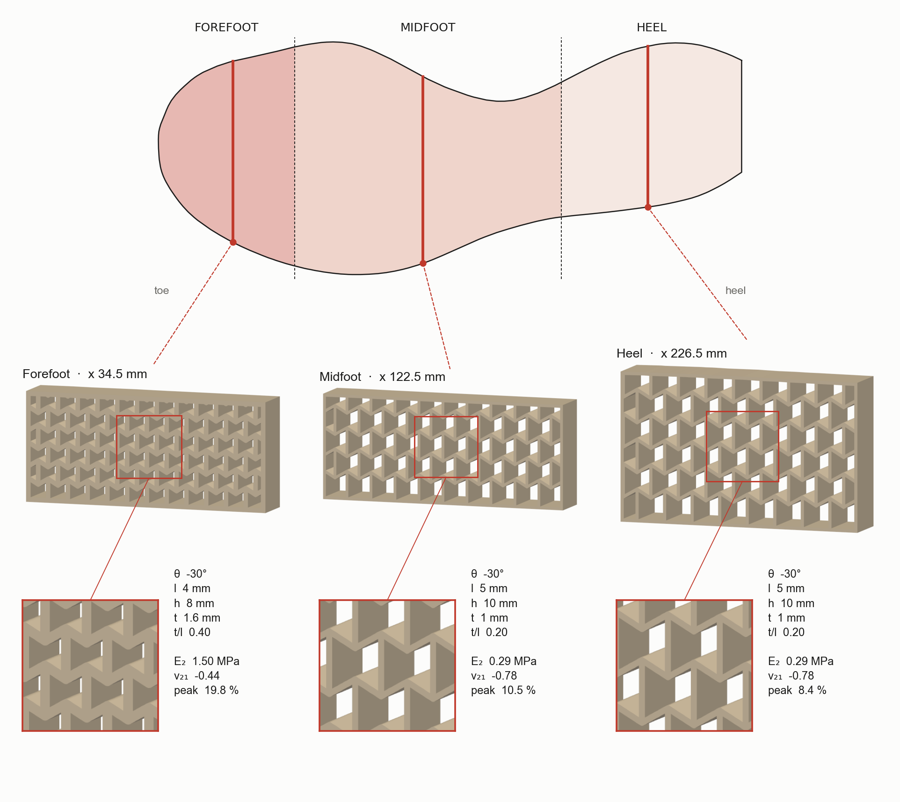

**Fig. 21b** Top: the midsole from above, shaded by zone, with the hinge lines dashed and the three sample slices marked. Below: each sample slice with its lattice enlarged and the zone's cell parameters and results.

---

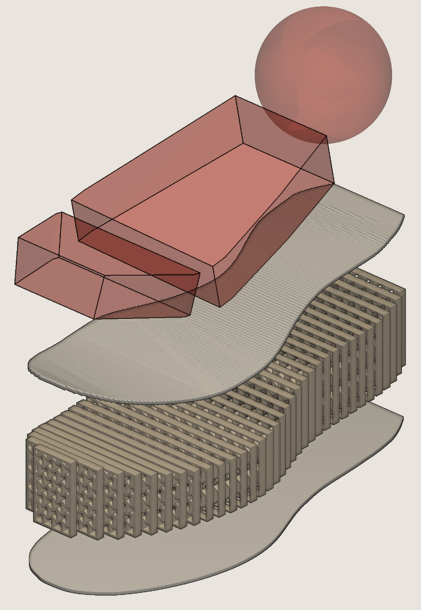

**Fig. 22** Zoned midsole, exploded: pseudo-foot (red), top plate, 34 slices, bottom plate.

## 2.6 Limitations and expansions

- **One runner.** A forefoot striker; a heel striker would load the heel and change the zoning.
- **Simplified foot.** Rigid heel–midfoot, literature MTP curve, no soft tissue.
- **Material.** Es is assumed from typical TPU data.
- **Lattice law.** Ohtaki has no buckling and over-predicts initial stiffness for thick, shallow cells; the calibrated search corrects the latter only.
- **Slices.** They interact only through the plates (Winkler, no inter-column shear).
- **Search.** 24 of 200 cells, one cell at a time; ANSYS checked small-strain stiffness only. A finer or swarm-based search [10] could explore zoned combinations.

**Expansions.** A buckling-aware lattice law calibrated on run C; evaluating the chiral, rotating-square and tensegrity concepts of the other strands through the same stance and midsole; and a three-dimensional re-entrant lattice that removes the slice gaps and domes under the foot.

---

# References

[1] Love, A. E. H. (1944). *A Treatise on the Mathematical Theory of Elasticity* (4th ed.). Dover.

[2] Lakes, R. (1987). Foam structures with a negative Poisson's ratio. *Science*, 235, 1038–1040.

[3] Evans, K. E., Nkansah, M. A., Hutchinson, I. J., & Rogers, S. C. (1991). Molecular network design. *Nature*, 353, 124.

[4] Gibson, L. J., Ashby, M. F., Schajer, G. S., & Robertson, C. I. (1982). The mechanics of two-dimensional cellular materials. *Proc. R. Soc. Lond. A*, 382, 25–42.

[5] Gibson, L. J., & Ashby, M. F. (1997). *Cellular Solids: Structure and Properties* (2nd ed.). Cambridge University Press.

[6] Masters, I. G., & Evans, K. E. (1996). Models for the elastic deformation of honeycombs. *Composite Structures*, 35, 403–422.

[7] Ohtaki, H., Hu, G., Nagasaka, Y., & Kotosaka, S. (2004). Analysis of negative Poisson's ratios of re-entrant honeycombs. *JSME International Journal Series A*, 47(2), 113–121. doi:10.1299/jsmea.47.113

[8] Malek, S., & Gibson, L. (2015). Effective elastic properties of periodic hexagonal honeycombs. *Mechanics of Materials*, 91, 226–240.

[9] Ren, X., Das, R., Tran, P., Ngo, T. D., & Xie, Y. M. (2018). Auxetic metamaterials and structures: a review. *Smart Materials and Structures*, 27, 023001.

[10] *Multidisciplinary optimization of shoe midsole structures using swarm intelligence.* ResearchGate, publication 382690657. https://www.researchgate.net/publication/382690657

[11] Stefanyshyn, D. J., & Nigg, B. M. (1997). Mechanical energy contribution of the metatarsophalangeal joint to running and sprinting. *Journal of Biomechanics*, 30, 1081–1085.

[12] Fukuchi, R. K., Fukuchi, C. A., & Duarte, M. (2017). A public dataset of running biomechanics and the effects of running speed on lower extremity kinematics and kinetics. *PeerJ*, 5, e3298.
